# Mail Merge Draft Helper

[中文说明](README.zh-CN.md) · [Chrome Web Store](https://chromewebstore.google.com/detail/mail-merge-draft-helper/dgfmchmfppcdjaacmdfmmgldbjldihpf) · [Ask a question or report a problem](https://github.com/dimitriparadise/outlook-gmail-mail-merge-chrome--edge-browser-extension/issues)

Mail Merge Draft Helper is a Chrome / Edge extension that turns an Excel or CSV list into personalized Outlook Web or Gmail emails. It is built for instructors, administrators, and small teams who send many similar messages but still want to review them before they go out.

Everything runs locally in the extension popup, which walks you through four steps: load a list, write one template with variables such as `{{First Name}}`, check the flagged recipients, then send yourself a test and open or send the emails in batches.

<p align="center">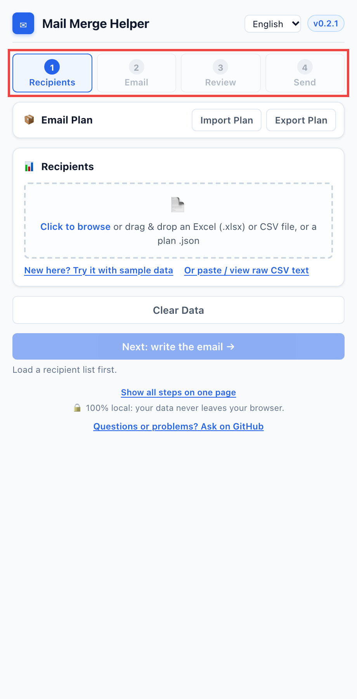</p>

**Highlights**

- **One step at a time:** Recipients → Email → Review → Send, with Back / Next buttons (or everything on one page, if you prefer).
- **Try it with sample data** in one click, without touching a real list.
- Load an **Excel (.xlsx)** or CSV file, and choose which columns to use. Grades, IDs, and other columns stay out unless you tick them.
- Type **`{{`** to pick a column, and give variables a default: `{{First Name|there}}`. Misspelled variables are flagged as you type.
- **Review notes** point out names that may not match the email address, unusual email domains, repeated addresses, and empty fields, and let you fix them in place.
- **Send yourself a test** before anything goes to the list.
- **Send in batches** (50 per batch by default) with a progress counter that is remembered.
- **Email plans:** save or load the list, template, and settings as one file.
- Interface in **English, 中文, and Español**.
- Optional **Auto-Send** (experimental).

## Contents

- [Install](#install)
- [Step-by-step tutorial](#step-by-step-tutorial)
- [Email plans (import / export)](#email-plans-import--export)
- [Auto-Send (experimental)](#auto-send-experimental)
- [Interface language](#interface-language)
- [Tips for large mailings](#tips-for-large-mailings)
- [Excel and CSV format](#excel-and-csv-format)
- [Troubleshooting](#troubleshooting)
- [Help and feedback](#help-and-feedback)
- [Privacy and permissions](#privacy-and-permissions)
- [Limitations](#limitations)
- [Development](#development)

## Install

### From the Chrome Web Store (recommended)

Open [Mail Merge Draft Helper on the Chrome Web Store](https://chromewebstore.google.com/detail/mail-merge-draft-helper/dgfmchmfppcdjaacmdfmmgldbjldihpf) and click **Add to Chrome**. Chrome keeps it up to date automatically.

Microsoft Edge can install it from the same page: when Edge asks, choose **Allow extensions from other stores**, then click **Get**.

Then click the puzzle-piece icon in the toolbar and pin **Mail Merge Draft Helper** so it is one click away.

### From GitHub (latest version)

A new version appears on [GitHub Releases](https://github.com/dimitriparadise/outlook-gmail-mail-merge-chrome--edge-browser-extension/releases) first and reaches the store after Chrome Web Store review. To use it right away, install it as an "unpacked" extension. This takes about a minute. If the store version is also installed, remove it first so the two copies do not both run.

1. Open the [latest release](https://github.com/dimitriparadise/outlook-gmail-mail-merge-chrome--edge-browser-extension/releases/latest) and download `mail-merge-draft-helper-<version>.zip`.
2. Unzip it into a folder you will keep (for example `Documents/mail-merge-draft-helper`). Do not delete this folder later: Chrome loads the extension from it.
3. In Chrome, go to `chrome://extensions` (in Edge: `edge://extensions`).
4. Turn on **Developer mode** (top right in Chrome; left sidebar in Edge).
5. Click **Load unpacked** and choose the unzipped folder (the one that contains `manifest.json`).

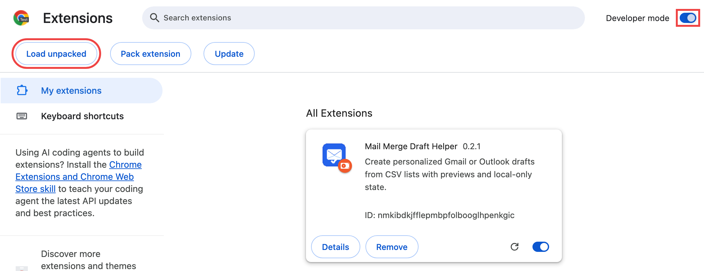

6. Click the puzzle-piece icon in the toolbar and pin **Mail Merge Draft Helper**.

**Updating:** download the new zip, replace the files in the same folder, then click the reload button (↻) on the extension's card in `chrome://extensions`.

## Step-by-step tutorial

The popup walks you through four steps. The step bar at the top shows where you are; **Next** moves on once the current step is done, and **Back** (or clicking an earlier step) goes back. Prefer to see everything at once? Click **Show all steps on one page** at the bottom of the popup; in that view, **Generate Drafts** takes the place of the Next buttons.

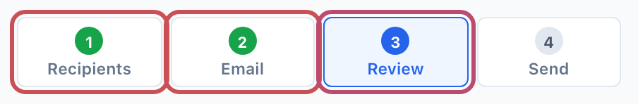

You can try every step with the files in [`examples/`](examples/), or click **New here? Try it with sample data** to load a made-up list and template and jump straight to the Review step. Nothing is sent unless you open drafts and click Send yourself.

### Step 1 — Recipients

Click the drop zone in **Recipients** and choose a file, or drag it onto the drop zone. Excel (`.xlsx`) and CSV both work.

**Excel files** open a column picker:

- **Email address column** is detected automatically. Change it if the wrong column is selected.
- Under **Columns to use in the email**, tick the columns your template needs. Name columns are ticked for you; everything else, such as grades and student IDs, stays out unless you tick it.
- If the workbook has several sheets, pick the sheet first.
- Click **Use These Columns**.

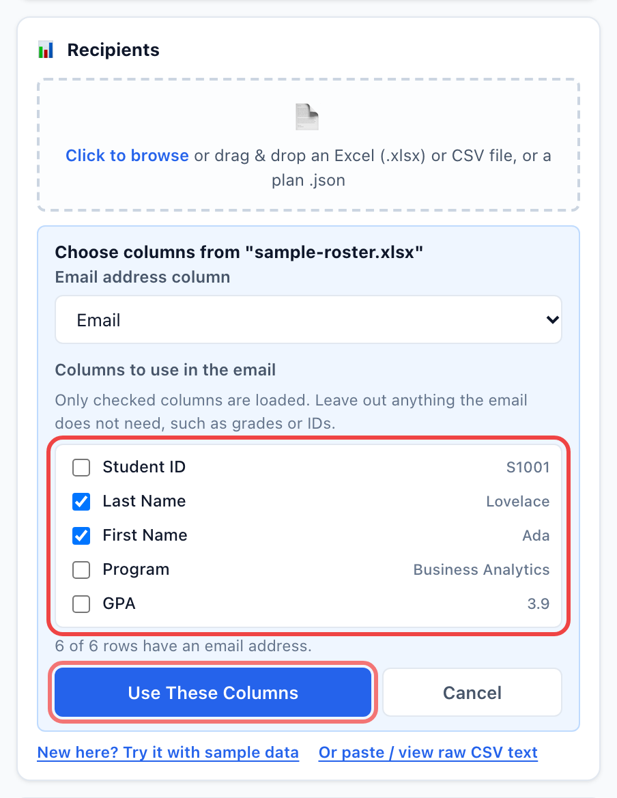

The badge then shows how many recipients were loaded (rows without an email address are skipped), and **Next: write the email** becomes available.

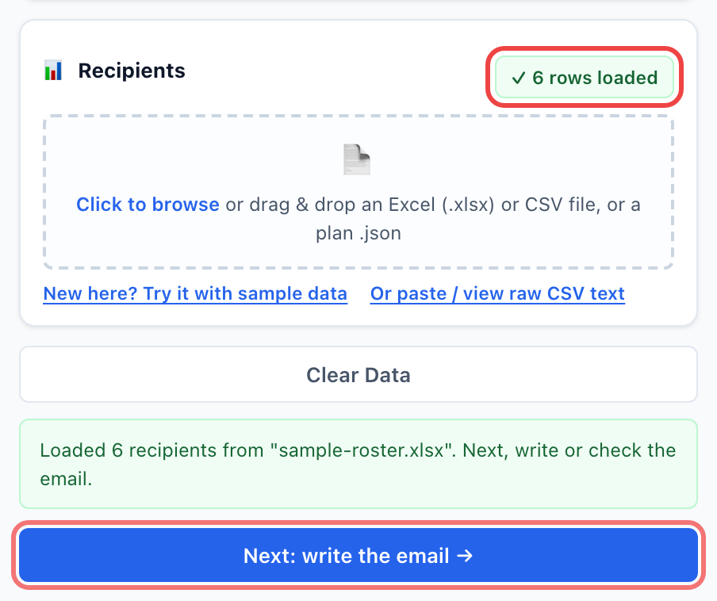

**CSV files** load directly. You can also click **Or paste / view raw CSV text** and paste a list. See [Excel and CSV format](#excel-and-csv-format).

> Already have everything prepared? Use **Import Plan** to load the list, subject, body, and settings in one go. See [Email plans](#email-plans-import--export).

### Step 2 — Email

Write the subject and body. Each `{{Variable}}` is replaced with the value from that recipient's row.

- **Type `{{`** to see the list of columns, then pick one with the arrow keys and Enter (or click it). The **Click to insert variable** buttons above the subject do the same.

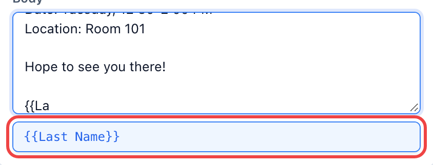

- **Give a variable a default** with `|`: `Hi {{First Name|there}},` becomes "Hi there," for anyone whose first name is empty.
- **Misspelled variables are flagged as you type**, with the closest column suggested:

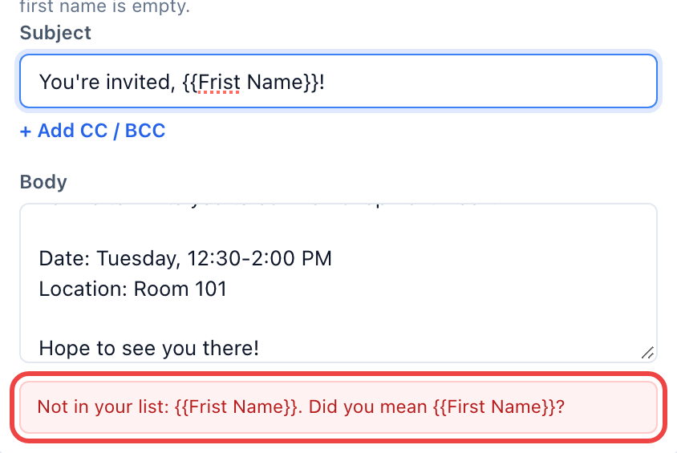

- Use **+ Add CC / BCC** for copy recipients. These fields accept variables too, such as `{{CcEmail}}`.
- The body is plain text: line breaks are kept, but there is no bold, color, or images.

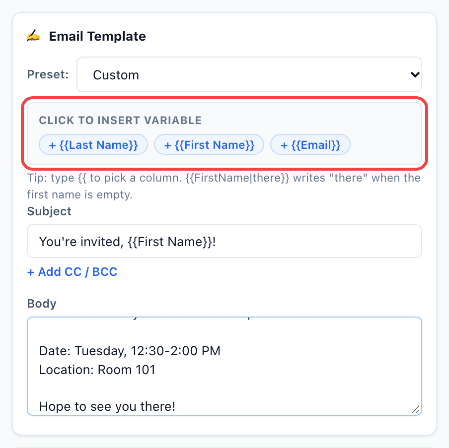

Click **Next: generate and review**. The extension builds one message per recipient. If something blocks sending (for example an unknown variable or an invalid address), you stay on this step and a red message explains what to fix.

### Step 3 — Review

**Review notes** (yellow box) list recipients worth a quick look. They never block sending:

- a first name that may not match the email address (for example "Bob" for `robert.smith@...`);
- an email domain that differs from most of the list (for example one `gmail.com` among school addresses);
- an address that appears on several rows and will get several emails (fine for one parent of two students);
- an empty value for a variable the template uses without a default.

Type a correction in the box to update that recipient right away, or click **It's fine** to hide the note.

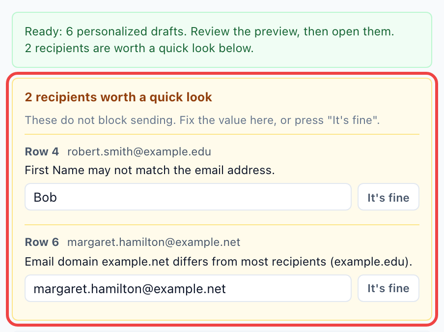

Then use **◀ Previous / Next ▶** to read a few personalized messages, and click **Next: send**.

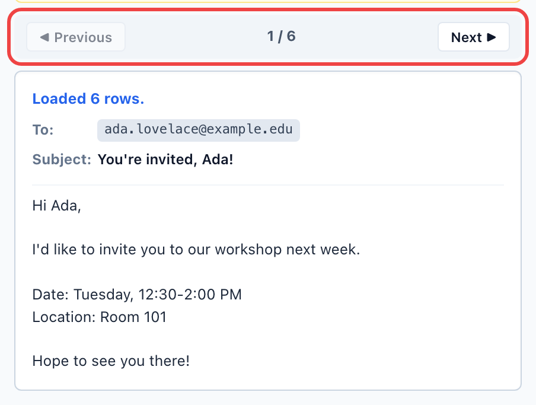

### Step 4 — Send

First check the settings:

- **Service Mode:** `Outlook Web` (outlook.office.com, work or school accounts) or `Gmail`.
- **Batch Opening Speed:** the pause between drafts. Use `2.0s (Safe / Large)` for long lists.
- **Emails per batch:** how many drafts the batch button opens at a time (default 50).
- **Auto-Send Drafts:** leave it unchecked until your test looks right. See [Auto-Send](#auto-send-experimental).

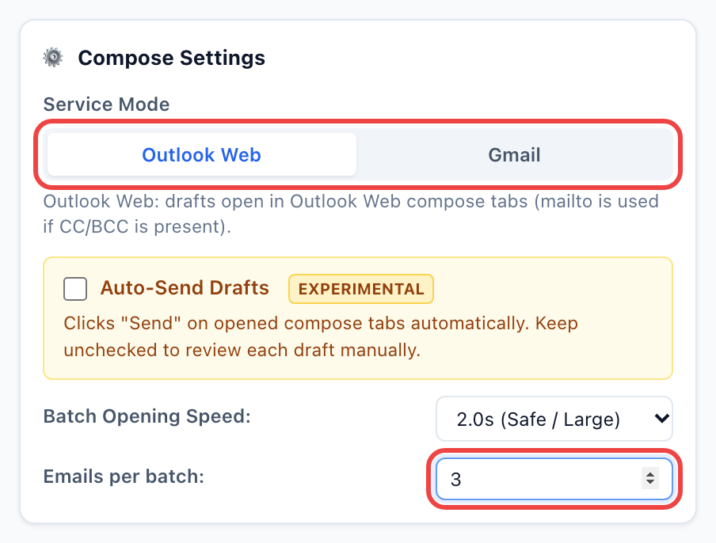

Then:

1. **Send yourself a test first:** enter your own email address and click **Open Test Draft to Me**. It uses the message shown in the preview, sends it only to you, and adds `[TEST]` to the subject. Your list and progress do not change.
2. **Send in batches:** click **Open Batch 1 of N**. Each draft opens in its own background tab, ready to review and send. The counter (for example `50 of 168 opened`) and the button move on to the next batch, and the popup remembers where you are even after it is closed.

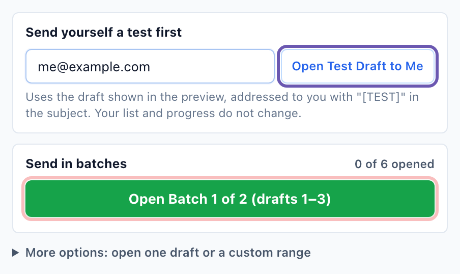

- Going back to change the template and generating again keeps your progress, so a batch is never opened twice by accident.
- Loading a new list, or editing the list by hand, starts the count over. **Reset progress** starts over on purpose.
- **More options** opens a single draft, or any From / To range. The batch button always picks up the drafts that have not been opened yet.

## Email plans (import / export)

An email plan is one `.json` file that sets up the whole popup at once: the recipient list, subject, body, CC, BCC, service mode, opening speed, and batch size. It is useful when you send the same kind of email again, or when someone prepares the mailing for you.

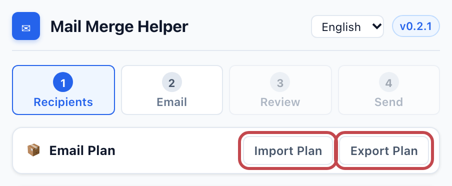

- **Import Plan** (or dropping a `.json` file on the drop zone) fills every field and loads the recipients. Then check the email and continue.
- **Export Plan** saves the current setup as `mail-merge-plan-YYYY-MM-DD.json`. The file contains your recipient list, so store it privately.
- Auto-Send is never saved in a plan and is always switched off after an import.

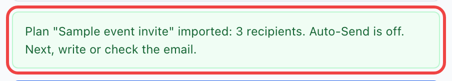

Plans are easy to write or edit by hand. `csv` and `body` can be a single string or an array of lines:

```json
{
  "type": "mail-merge-plan",
  "version": 1,
  "name": "Sample event invite",
  "csv": ["FirstName,Email", "Ada,ada@example.com"],
  "subject": "You're invited, {{FirstName}}!",
  "body": ["Hi {{FirstName}},", "", "Hope to see you there!"],
  "settings": { "composeMode": "outlook", "batchDelay": 2000, "batchSize": 50 }
}
```

`composeMode` is `outlook` or `gmail`; `batchDelay` is `500`, `1000`, or `2000` (milliseconds); `batchSize` is 1–500. A complete example is in [`examples/sample-plan.json`](examples/sample-plan.json).

## Auto-Send (experimental)

When **Auto-Send Drafts** is checked, the extension also clicks **Send** in each compose tab it opens, then tries to close the tab. The buttons change to **Send Test to Me**, **Send Batch 1 of N**, and so on, so it is always clear that emails will go out.

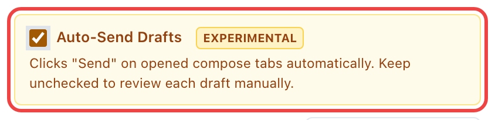

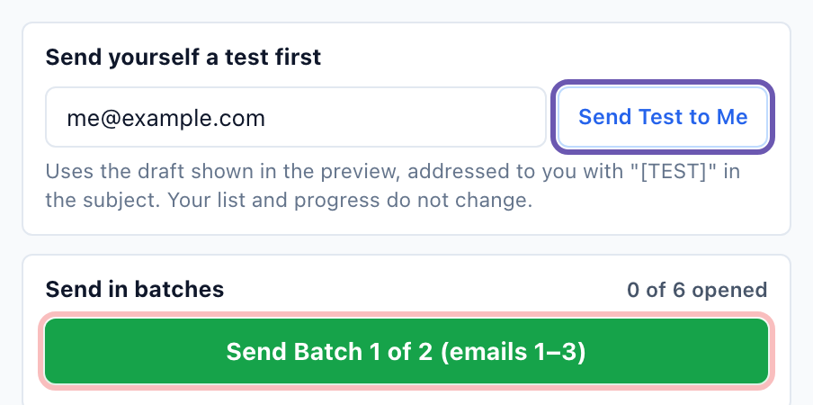

Before relying on it:

- **Send yourself a test first** with Auto-Send on. Check that it arrives and that the compose tab did not just stay open.
- It only acts on compose tabs opened by the extension, and only on the matching draft.
- It recognizes Send buttons labeled "Send" or "发送". If your Outlook or Gmail uses another language, it gives up after 15 seconds and leaves the draft open for you.
- In Outlook mode it cannot be combined with CC or BCC (those drafts use `mailto:`). Use Gmail mode or turn Auto-Send off.
- After an extension update, reload it in `chrome://extensions` so the new version runs.

## Interface language

Use the menu in the top-right corner of the popup to switch between **English**, **中文**, and **Español**. The first time, the popup follows your browser's language. Your choice is remembered.

## Tips for large mailings

- **Keep batches to about 40–50** (the default is 50) and leave a few minutes between batches. Mail providers may throttle or flag accounts that send many messages in a short burst.
- **Always send yourself a test first**, especially before using Auto-Send.
- **Use `2.0s (Safe / Large)` speed** so the browser and Outlook keep up.
- **Only load the columns the email needs.** The Excel column picker leaves everything else out.
- **Read the review notes**: they catch nicknames, personal addresses, repeated addresses, and missing names before the email goes out.

## Excel and CSV format

The list needs a header row, at least one data row, and an email column (`Email`, `E-mail`, `Mail`, `邮箱`, `Correo`, `To`, or a column whose header contains "email"). Any header can be used as a variable:

```csv
FirstName,LastName,Email,Course,CcEmail
Ada,Lovelace,ada.lovelace@example.com,ISOM 210,ta@example.com
Grace,Hopper,grace.hopper@example.com,ISOM 340,ta@example.com
```

```text
Subject:  Reminder for {{Course}}
Body:     Hi {{FirstName}},

          This is a quick reminder about {{Course}}.
CC:       {{CcEmail}}
```

- **Excel:** `.xlsx` files are read directly; the first non-empty row is used as the header. Cells keep the value Excel saved (formulas are not recalculated, and dates appear as Excel date numbers, so format dates as text if the email needs them). Old `.xls` files are not supported: save them as `.xlsx` or CSV UTF-8.
- **CSV:** values that contain commas or line breaks must be wrapped in double quotes. When saving from Excel, choose **CSV UTF-8** so non-English names are kept intact.
- Variable names are case-sensitive and must match the header exactly, including spaces: a column named `First Name` is used as `{{First Name}}`.
- Add a default after `|` for values that may be empty: `{{First Name|there}}`.

## Troubleshooting

| Problem | What to do |
|---|---|
| "Old .xls files are not supported" | In Excel, use **File → Save As** and choose `.xlsx` or **CSV UTF-8**. |
| "Could not read this Excel file" | Open it in Excel and save it again as `.xlsx`. Password-protected files cannot be read. |
| "CSV needs a header row and at least one data row" | Make sure the first line is the header and each recipient is on its own line. |
| **Next** is greyed out on the first step | Load a recipient list first. If the Excel column picker is open, click **Use These Columns**. |
| "Not in your list: {{...}}" under the template | The variable name does not match a column header exactly (spelling, capitals, and spaces). Use the suggested name, or type `{{` and pick from the list. |
| "Hi ," with a missing name | Add a default: `{{First Name|there}}`. |
| A name looks wrong in the preview | Fix it in the review notes, or in the original file and load it again. |
| Outlook opens but the To / Subject is empty | Make sure you are signed in to Outlook Web in the same browser profile, then open the draft again. |
| Auto-Send did not click Send | Reload the extension in `chrome://extensions`, check the language of the Send button, and see [Auto-Send](#auto-send-experimental). |
| The batch button says "All batches opened" but I need to resend | Click **Reset progress**, or use **More options** to open a specific range. |
| Start over completely | Click **Clear Data**. This removes the saved list, templates, and progress. |

## Help and feedback

If something does not work, or you have a question or an idea, open an issue on [GitHub Issues](https://github.com/dimitriparadise/outlook-gmail-mail-merge-chrome--edge-browser-extension/issues). The popup links there too: under every error message, and at the bottom of the popup.

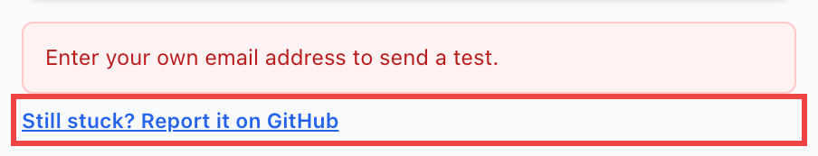

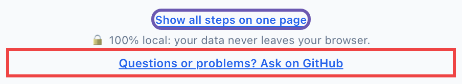

When reporting a problem, please include the extension version (shown next to the language menu), your browser, Outlook or Gmail, and the exact message you saw. **Do not post real recipient lists or student data**; use made-up names and `example.com` addresses instead.

## Privacy and permissions

Mail Merge Draft Helper has no backend and does not send your data to any server. Excel and CSV files are read inside the popup. The loaded list, templates, generated drafts, and progress are kept in the browser's extension storage so you can close and reopen the popup without losing your place. **Clear Data** removes them. Exported plan files are saved only where your browser saves downloads.

Permissions:

- `storage`: saves the popup state locally.
- Gmail and Outlook host permissions: let the optional Auto-Send script find the compose window that the extension opened.

The extension does not read your mailbox and does not use the Gmail API or Microsoft Graph. Full policy: [store-assets/privacy-policy.md](store-assets/privacy-policy.md).

## Limitations

- No attachments (drafts are opened through compose links).
- Plain-text body only; no rich-text formatting.
- Very long emails can exceed what a compose link can carry.
- Auto-Send is experimental and depends on the Outlook / Gmail page layout.

## Development

1. Clone this repository.
2. Load the repository folder itself with **Load unpacked** (see [Install](#install)).
3. After editing, click the reload button on the extension card.

```bash
node --test
```

```bash
./scripts/build_release.sh
```

- `popup.html` / `popup.js` / `popup.css`: the popup. `xlsx.js` reads Excel files; `content.js` is the Auto-Send script.
- `i18n.js` holds every popup string in English, Chinese, and Spanish. Add a new string to all three languages; a test checks that the keys and `{placeholders}` match.
- `build_release.sh` copies the extension files to `dist/mail-merge-draft-helper/` and creates `dist/mail-merge-draft-helper-<version>.zip` using the version in `manifest.json`.

Publishing notes for the Chrome Web Store (listing text, screenshots, review notes, checklist) are in [`store-assets/`](store-assets/). Official references:

- [Publish in the Chrome Web Store](https://developer.chrome.com/docs/webstore/publish)
- [Chrome Web Store Developer Program Policies](https://developer.chrome.com/docs/webstore/program-policies)
- [Privacy disclosure requirements](https://developer.chrome.com/docs/webstore/program-policies/user-data-faq)
