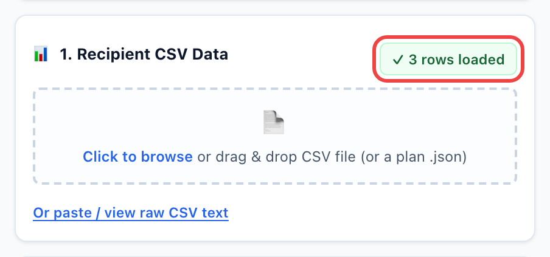
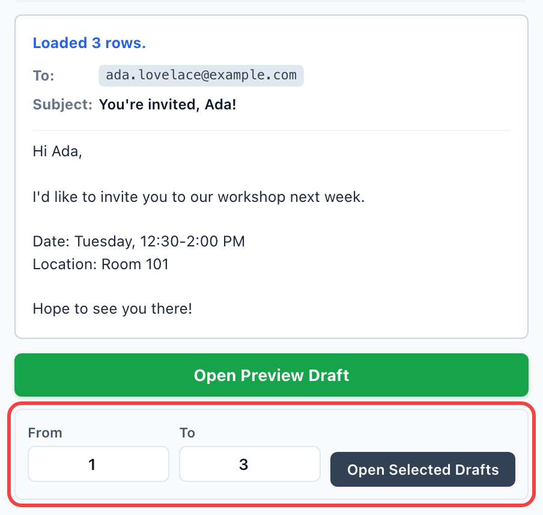

# Mail Merge Draft Helper

[中文说明](README.zh-CN.md)

Mail Merge Draft Helper is a lightweight Chrome / Edge extension that turns a CSV list into personalized Outlook Web or Gmail emails. It is built for instructors, administrators, and small teams who send many similar messages but still want to review each one before it goes out.

Everything runs locally in the extension popup. You load a recipient list, write one template with variables such as `{{FirstName}}`, preview every personalized message, and open the drafts in Outlook Web or Gmail, one at a time or in batches.

<p align="center"></p>

## Contents

- [Install](#install)
- [Step-by-step tutorial](#step-by-step-tutorial)
- [Email plans (import / export)](#email-plans-import--export)
- [Auto-Send (experimental)](#auto-send-experimental)
- [Tips for large mailings](#tips-for-large-mailings)
- [CSV format](#csv-format)
- [Troubleshooting](#troubleshooting)
- [Privacy and permissions](#privacy-and-permissions)
- [Limitations](#limitations)
- [Development](#development)

## Install

The extension is not on the Chrome Web Store yet, so it is installed as an "unpacked" extension. This takes about a minute.

1. Open the [latest release](https://github.com/dimitriparadise/outlook-gmail-mail-merge-chrome--edge-browser-extension/releases/latest) and download `mail-merge-draft-helper-<version>.zip`.
2. Unzip it into a folder you will keep (for example `Documents/mail-merge-draft-helper`). Do not delete this folder later: Chrome loads the extension from it.
3. In Chrome, go to `chrome://extensions` (in Edge: `edge://extensions`).
4. Turn on **Developer mode** (top right in Chrome; left sidebar in Edge).
5. Click **Load unpacked** and choose the unzipped folder (the one that contains `manifest.json`).


6. Click the puzzle-piece icon in the toolbar and pin **Mail Merge Draft Helper** so it is one click away.

**Updating:** download the new zip, replace the files in the same folder, then click the reload button (↻) on the extension's card in `chrome://extensions`.

## Step-by-step tutorial

The popup has three numbered cards (recipients, template, settings), followed by **Generate Drafts**, a preview, and the buttons that open drafts.

### Step 1 — Load your recipient list

Click the drop zone in **1. Recipient CSV Data** and choose a CSV file, or drag the file onto it. The badge shows how many rows were loaded. You can also click **Or paste / view raw CSV text** and paste the CSV directly.



The CSV needs a header row and an email column (`Email`, `E-mail`, `Mail`, `邮箱`, `To`, ...). Every other column becomes a template variable. Try it with [`examples/sample-recipients.csv`](examples/sample-recipients.csv), or see [CSV format](#csv-format).

> Already have everything prepared? Use **Import Plan** instead to load the list, subject, body, and settings in one go. See [Email plans](#email-plans-import--export).

### Step 2 — Write the template

In **2. Email Template**, write the subject and body. The **Click to insert variable** panel shows one button per CSV column; click a button to insert that variable where your cursor is. Each `{{Variable}}` is replaced with the value from that recipient's row.


- Use **+ Add CC / BCC** for copy recipients. These fields accept variables too, such as `{{CcEmail}}`.
- The **Preset** menu has a starter template you can overwrite.
- The body is plain text: line breaks are kept, but there is no bold, color, or images.

### Step 3 — Choose the mail service and speed

In **3. Compose Settings**:

- **Service Mode:** `Outlook Web` (outlook.office.com, work or school accounts) or `Gmail`.
- **Batch Opening Speed:** the pause between drafts when you open a range. Use `2.0s (Safe / Large)` for lists longer than a few dozen.
- **Auto-Send Drafts:** leave it unchecked until you have tested your setup. See [Auto-Send](#auto-send-experimental).


### Step 4 — Generate and preview

Click **Generate Drafts**. The extension builds one message per row and shows a preview. Use **◀ Previous / Next ▶** to check a few recipients: the names, subject, and body should all be filled in.


If something is wrong, a red preflight warning lists it (for example an unknown variable such as `{{Coursee}}`, an invalid or duplicate email address, or the same address in To and CC). Fix the CSV or template and click **Generate Drafts** again.

### Step 5 — Open the drafts

- **Open Preview Draft** opens the message you are currently previewing.
- To open many at once, enter a **From / To** range (row numbers, starting at 1) and click **Open Selected Drafts**. Each draft opens in its own background tab, using the speed from Step 3.



Each tab is a normal Outlook or Gmail compose window with the recipient, subject, and body filled in. Review it and click **Send** yourself. The extension remembers how far you got, so after closing and reopening the popup the range starts where you left off.

## Email plans (import / export)

An email plan is one `.json` file that sets up the whole popup at once: the recipient list, subject, body, CC, BCC, service mode, and opening speed. It is useful when you send the same kind of email again, or when someone prepares the mailing for you.


- **Import Plan** (or dropping a `.json` file on the CSV drop zone) fills every field and loads the recipients. Then review the template and click **Generate Drafts**.
- **Export Plan** saves the current setup as `mail-merge-plan-YYYY-MM-DD.json`. The file contains your recipient list, so store it privately.
- Auto-Send is never saved in a plan and is always switched off after an import.


Plans are easy to write or edit by hand. `csv` and `body` can be a single string or an array of lines:

```json
{
  "type": "mail-merge-plan",
  "version": 1,
  "name": "Sample event invite",
  "csv": ["FirstName,Email", "Ada,ada@example.com"],
  "subject": "You're invited, {{FirstName}}!",
  "body": ["Hi {{FirstName}},", "", "Hope to see you there!"],
  "settings": { "composeMode": "outlook", "batchDelay": 2000 }
}
```

`composeMode` is `outlook` or `gmail`; `batchDelay` is `500`, `1000`, or `2000` (milliseconds). A complete example is in [`examples/sample-plan.json`](examples/sample-plan.json).

## Auto-Send (experimental)

When **Auto-Send Drafts** is checked, the extension also clicks **Send** in each compose tab it opens, then tries to close the tab. The buttons change to **Open & Send Preview Email** and **Open & Send Selected Emails** so it is always clear that emails will go out.


Before relying on it:

- **Send one test email to yourself first.** Put your own address in the first row and send only row 1. Check that it arrives and that the compose tab did not just stay open.
- It only acts on compose tabs opened by the extension, and only on the matching draft.
- It recognizes Send buttons labeled "Send" or "发送". If your Outlook or Gmail uses another language, it gives up after 15 seconds and leaves the draft open for you.
- In Outlook mode it cannot be combined with CC or BCC (those drafts use `mailto:`). Use Gmail mode or turn Auto-Send off.
- After an extension update, reload it in `chrome://extensions` so the new version runs.

## Tips for large mailings

- **Split the list into batches of about 40–50.** Load the whole list and send rows 1–50, then 51–100 later; or prepare one CSV or plan per batch.
- **Leave some time between batches.** Mail providers may throttle or flag accounts that send many messages in a short burst.
- **Test with yourself first** (row 1 = your own address), especially before using Auto-Send.
- **Use `2.0s (Safe / Large)` speed** so the browser and Outlook keep up.
- **Keep the list minimal.** Only include the columns the template needs; leave out grades, IDs, and other sensitive fields.

## CSV format

The CSV needs a header row, at least one data row, and an email column. Any header can be used as a variable:

```csv
FirstName,LastName,Email,Course,CcEmail
Ada,Lovelace,ada.lovelace@example.com,ISOM 210,ta@example.com
Grace,Hopper,grace.hopper@example.com,ISOM 340,ta@example.com
```

```text
Subject:  Reminder for {{Course}}
Body:     Hi {{FirstName}},

          This is a quick reminder about {{Course}}.
CC:       {{CcEmail}}
```

- Values that contain commas or line breaks must be wrapped in double quotes.
- Variable names are case-sensitive: `{{firstname}}` does not match a `FirstName` column.
- When pasting, there must be a real line break between the header row and the first data row; wrapping inside the text box does not count.
- Excel: use **File → Save As → CSV UTF-8** so non-English names are kept intact.

## Troubleshooting

| Problem | What to do |
|---|---|
| "CSV needs a header row and at least one data row" | Make sure the first line is the header and each recipient is on its own line. |
| Preflight warning "Unknown template variable" | The variable name does not match a CSV header exactly (spelling and capitalization). |
| A `{{Variable}}` shows up literally in the email | Same as above, or that row's cell is empty. |
| Outlook opens but the To / Subject is empty | Make sure you are signed in to Outlook Web in the same browser profile, then open the draft again. |
| Auto-Send did not click Send | Reload the extension in `chrome://extensions`, check the language of the Send button, and see [Auto-Send](#auto-send-experimental). |
| Tabs open too fast or some fail | Choose `2.0s (Safe / Large)` and send smaller ranges. |
| Start over | Click **Clear Data**. This removes the saved list, templates, and progress. |

## Privacy and permissions

Mail Merge Draft Helper has no backend and does not send your data to any server. The CSV, templates, generated drafts, and progress are kept in the browser's extension storage so you can close and reopen the popup without losing your place. **Clear Data** removes them. Exported plan files are saved only where your browser saves downloads.

Permissions:

- `storage`: saves the popup state locally.
- Gmail and Outlook host permissions: let the optional Auto-Send script find the compose window that the extension opened.

The extension does not read your mailbox and does not use the Gmail API or Microsoft Graph. Full policy: [store-assets/privacy-policy.md](store-assets/privacy-policy.md).

## Limitations

- No attachments (drafts are opened through compose links).
- Plain-text body only; no rich-text formatting.
- Very long emails can exceed what a compose link can carry.
- Auto-Send is experimental and depends on the Outlook / Gmail page layout.

## Development

1. Clone this repository.
2. Load the repository folder itself with **Load unpacked** (see [Install](#install)).
3. After editing, click the reload button on the extension card.

```bash
node --test
```

```bash
./scripts/build_release.sh
```

`build_release.sh` copies the extension files to `dist/mail-merge-draft-helper/` and creates `dist/mail-merge-draft-helper-<version>.zip` using the version in `manifest.json`.

Publishing notes for the Chrome Web Store (listing text, screenshots, review notes, checklist) are in [`store-assets/`](store-assets/). Official references:

- [Publish in the Chrome Web Store](https://developer.chrome.com/docs/webstore/publish)
- [Chrome Web Store Developer Program Policies](https://developer.chrome.com/docs/webstore/program-policies)
- [Privacy disclosure requirements](https://developer.chrome.com/docs/webstore/program-policies/user-data-faq)
