# Mail Merge Draft Helper 中文说明

[English](README.md) · [Chrome 应用商店](https://chromewebstore.google.com/detail/mail-merge-draft-helper/dgfmchmfppcdjaacmdfmmgldbjldihpf) · [提问或反馈问题](https://github.com/dimitriparadise/outlook-gmail-mail-merge-chrome--edge-browser-extension/issues)

Mail Merge Draft Helper 是一个 Chrome / Edge 扩展，可以把一份 Excel 或 CSV 名单变成一封封个性化的 Outlook Web 或 Gmail 邮件。适合老师、行政人员和小团队：要发很多封内容相似的邮件，但发出去之前还想自己检查一遍。

所有操作都在扩展弹窗里、在你自己的浏览器本地完成，弹窗会带你一步步走完：载入名单，写一份带变量（比如 `{{First Name}}`）的模板，看一眼被标出来的收件人，然后先给自己发一封测试，再分批打开或发送。

<p align="center">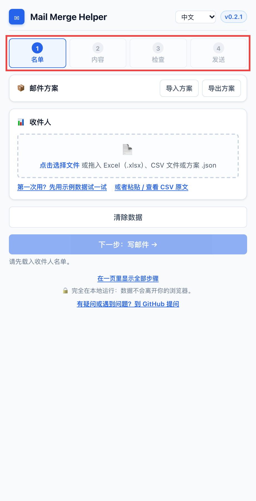</p>

**主要功能**

- **一步一步来**：名单 → 内容 → 检查 → 发送，用"上一步 / 下一步"切换（也可以改成全部显示在一页）。
- **一键用示例数据试一试**，不用碰真实名单。
- 直接载入 **Excel（.xlsx）** 或 CSV，并选择要用哪些列。成绩、学号等其他列默认不载入。
- 输入 **`{{`** 就能选列名；变量可以设默认值，比如 `{{First Name|同学}}`；变量写错会当场提示。
- **收件人检查**：标出名字可能和邮箱对不上、邮箱后缀与众不同、同一邮箱出现多次、字段为空的收件人，可以直接在弹窗里修改。
- **先给自己发测试**，确认无误再发给名单。
- **分批发送**（默认每批 50 封），自动记住进度。
- **邮件方案**：把名单、模板和设置保存成一个文件，或一次性导入。
- 界面支持 **English、中文、Español**。
- 可选的 **自动发送**（实验功能）。

## 目录

- [安装](#安装)
- [分步教程](#分步教程)
- [邮件方案（导入 / 导出）](#邮件方案导入--导出)
- [自动发送（实验功能）](#自动发送实验功能)
- [界面语言](#界面语言)
- [大批量发送建议](#大批量发送建议)
- [Excel 和 CSV 格式](#excel-和-csv-格式)
- [常见问题](#常见问题)
- [帮助和反馈](#帮助和反馈)
- [隐私和权限](#隐私和权限)
- [当前限制](#当前限制)
- [开发](#开发)

## 安装

### 从 Chrome 应用商店安装（推荐）

打开 [Chrome 应用商店里的 Mail Merge Draft Helper](https://chromewebstore.google.com/detail/mail-merge-draft-helper/dgfmchmfppcdjaacmdfmmgldbjldihpf)，点击 **添加至 Chrome（Add to Chrome）**。之后 Chrome 会自动更新。

Microsoft Edge 也可以从同一个页面安装：Edge 提示时选择 **允许来自其他应用商店的扩展**，再点 **获取**。

装好后点击工具栏上的拼图图标，把 **Mail Merge Draft Helper** 固定（📌）在工具栏上，方便一键打开。

### 从 GitHub 安装（最新版本）

新版本会先发布在 [GitHub Releases](https://github.com/dimitriparadise/outlook-gmail-mail-merge-chrome--edge-browser-extension/releases)，通过 Chrome 应用商店审核后才会出现在商店里。想马上用最新版，可以用"未打包扩展"的方式安装，大约一分钟。如果已经装了商店版，请先移除，避免两份同时运行。

1. 打开 [最新版本（Releases）](https://github.com/dimitriparadise/outlook-gmail-mail-merge-chrome--edge-browser-extension/releases/latest)，下载 `mail-merge-draft-helper-<版本号>.zip`。
2. 解压到一个会长期保留的文件夹，比如 `Documents/mail-merge-draft-helper`。之后不要删掉这个文件夹，Chrome 是从这里加载扩展的。
3. 在 Chrome 地址栏打开 `chrome://extensions`（Edge 打开 `edge://extensions`）。
4. 打开 **Developer mode（开发者模式）**：Chrome 在右上角，Edge 在左侧栏。
5. 点击 **Load unpacked（加载已解压的扩展程序）**，选择刚才解压出来、里面有 `manifest.json` 的那个文件夹。

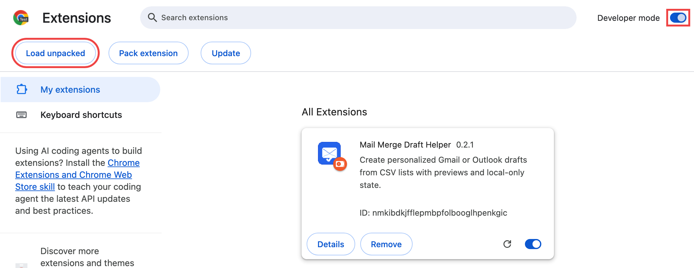

6. 点击工具栏上的拼图图标，把 **Mail Merge Draft Helper** 固定在工具栏上。

**更新版本：** 下载新的 zip，把同一个文件夹里的文件替换掉，然后在 `chrome://extensions` 里点这个扩展卡片上的刷新按钮（↻）。

## 分步教程

弹窗会带你走四步。顶部的步骤条显示你在哪一步；当前步骤完成后点 **下一步**，点 **上一步**（或点前面的步骤）可以返回。想一次看到全部内容，可以点弹窗底部的 **在一页里显示全部步骤**；在那种视图里，由 **生成草稿** 按钮代替"下一步"。

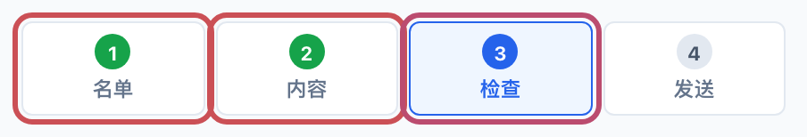

每一步都可以用 [`examples/`](examples/) 里的示例文件试一试；也可以点 **第一次用？先用示例数据试一试**，一键载入虚构的名单和模板，直接跳到"检查"这一步。除非你自己打开草稿并点发送，否则不会发出任何邮件。

### 第 1 步：名单

点击 **收件人** 里的虚线框选择文件，或者直接把文件拖进去。Excel（`.xlsx`）和 CSV 都可以。

**Excel 文件**会先弹出"选择列"：

- **邮箱地址所在列** 会自动识别，选错了可以改。
- 在 **邮件中要用到的列** 里，勾选模板需要的列。名字相关的列会自动勾上；成绩、学号等其他列默认不勾，不会被载入。
- 如果有多个工作表，先选工作表。
- 点击 **使用这些列**。

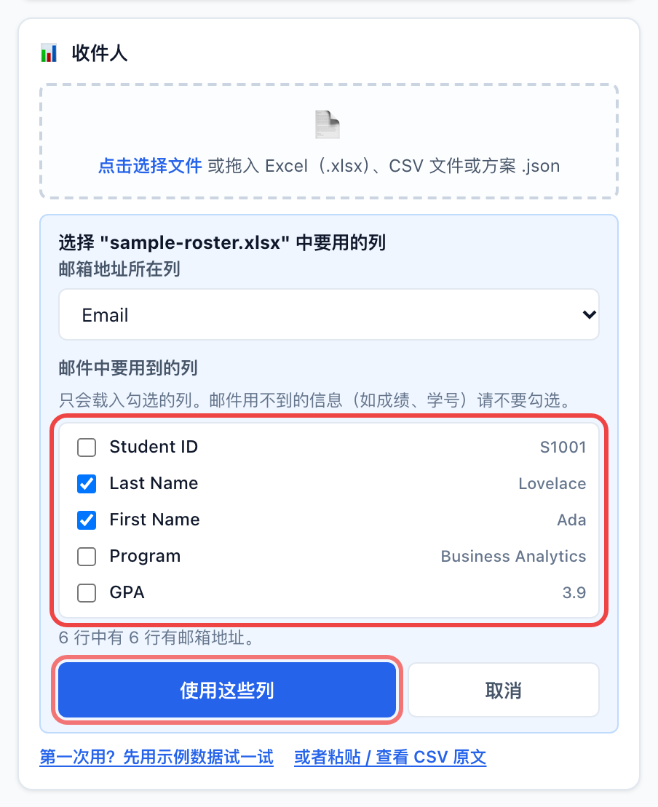

右上角会显示载入了多少位收件人（没有邮箱地址的行会被跳过），**下一步：写邮件** 也可以点了。

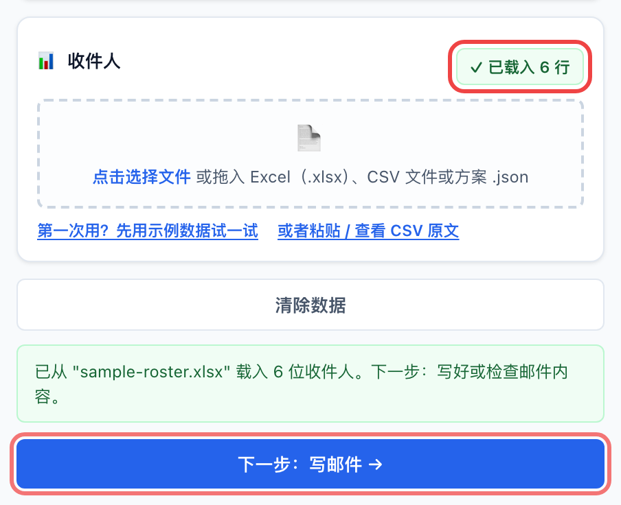

**CSV 文件**会直接载入。也可以点 **或者粘贴 / 查看 CSV 原文**，直接粘贴名单。格式见 [Excel 和 CSV 格式](#excel-和-csv-格式)。

> 如果名单、主题、正文都已经准备好了，可以点 **导入方案** 一次性载入，见 [邮件方案](#邮件方案导入--导出)。

### 第 2 步：内容

填写主题和正文。发送时每个 `{{变量}}` 都会换成这位收件人那一行的值。

- **输入 `{{`** 会弹出列名列表，用方向键和回车选择（或直接点）。主题上方的 **点击插入变量** 按钮也可以插入。

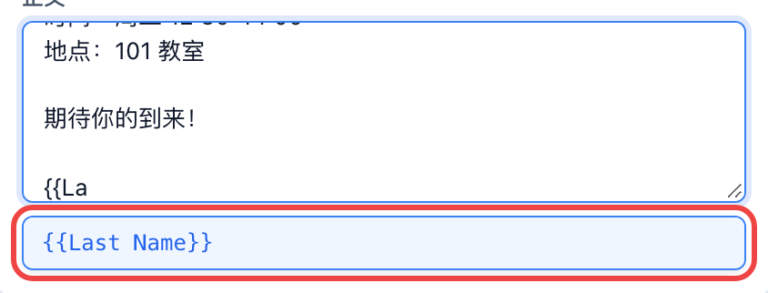

- **给变量设默认值**，用 `|` 隔开：`{{First Name|同学}} 你好` 在名字为空时会变成"同学 你好"。
- **变量写错会当场提示**，并给出最接近的列名：

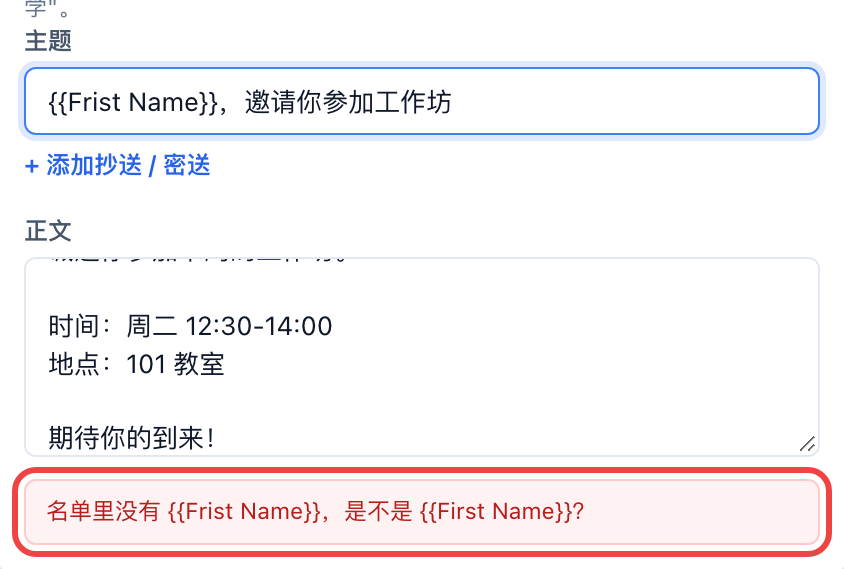

- 需要抄送时，点 **+ 添加抄送 / 密送**。抄送栏里也可以用变量，比如 `{{CcEmail}}`。
- 正文是纯文本：换行会保留，但不能加粗、改颜色或插图片。

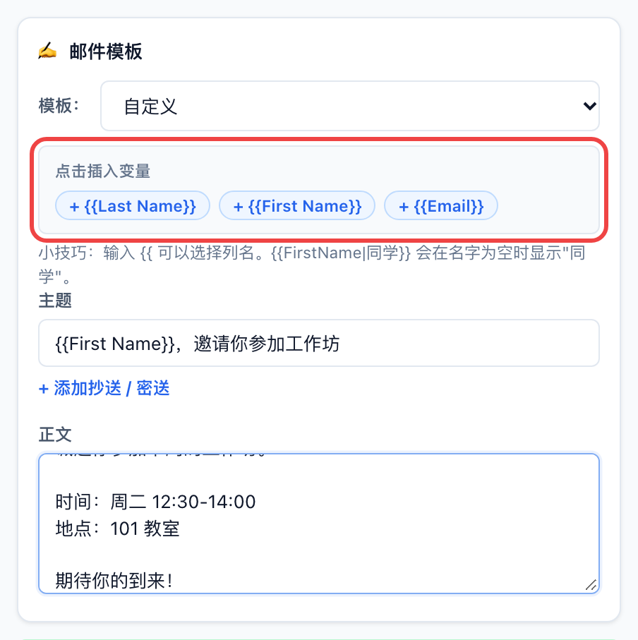

点 **下一步：生成并检查**，扩展会为每位收件人生成一封邮件。如果有必须先处理的问题（比如变量不存在、邮箱无效），会停在这一步，并用红色提示说明要改什么。

### 第 3 步：检查

**收件人检查**（黄色框）会列出建议看一眼的收件人，但不会阻止发送：

- 名字可能和邮箱对不上（比如名字是 "Bob"，邮箱是 `robert.smith@...`）；
- 邮箱后缀和大多数人不一样（比如一群学校邮箱里有一个 `gmail.com`）；
- 同一个邮箱出现在好几行，会收到好几封（比如一位家长有两个孩子，这是正常的）；
- 模板用到的某个字段是空的，而且没有设默认值。

可以直接在框里改，改完立即生效；没问题的话点 **没问题** 隐藏这条提示。

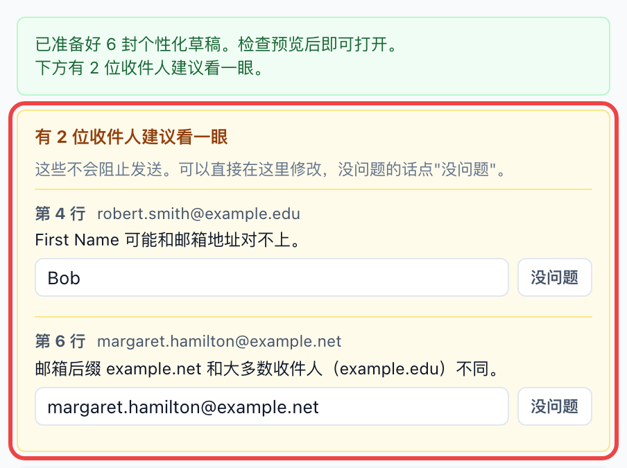

然后用 **◀ 上一封 / 下一封 ▶** 翻几封看看，再点 **下一步：发送**。

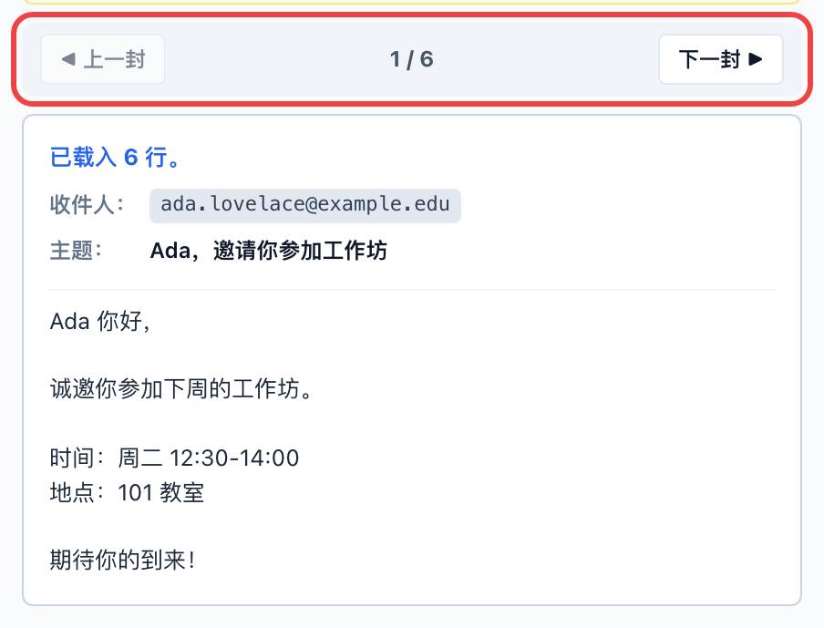

### 第 4 步：发送

先看一下设置：

- **邮箱服务：** `Outlook Web`（outlook.office.com，学校或工作账号）或 `Gmail`。
- **打开间隔：** 两封草稿之间的间隔。名单较长时选 `2 秒（稳妥 / 大批量）`。
- **每批封数：** 分批按钮一次打开多少封（默认 50）。
- **自动发送：** 测试邮件没问题之前先不要勾，见 [自动发送](#自动发送实验功能)。

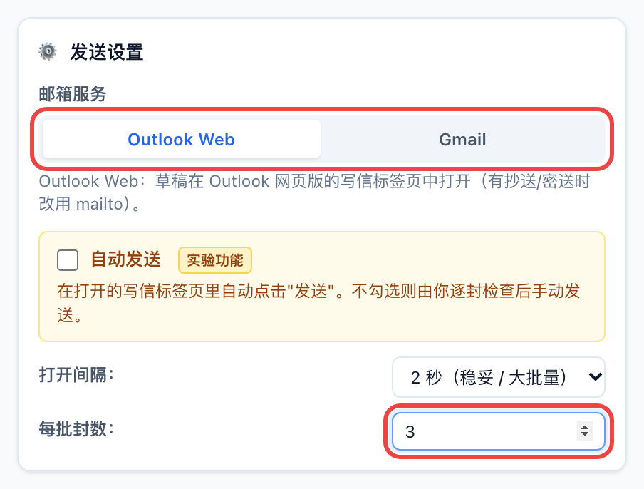

然后：

1. **先给自己发一封测试：** 填上你自己的邮箱，点 **打开测试草稿（发给我）**。它会用预览里的这封邮件，只发给你自己，主题前加 `[TEST]`。名单和进度都不会改变。
2. **分批发送：** 点 **打开第 1 批 / 共 N 批**。每封草稿会在后台单独打开一个标签页，检查后发送即可。计数（比如"已打开 50 / 168"）和按钮会自动跳到下一批；关掉弹窗再打开也会记住进度。

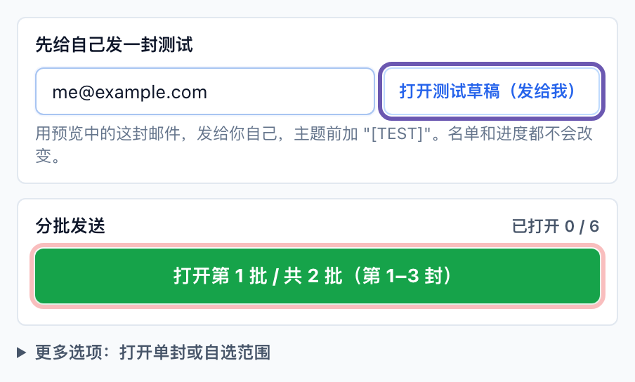

- 回去改模板后再生成，进度会保留，不会把已经发过的那批再打开一遍。
- 载入新名单、或手动修改名单原文后，进度会从头开始。想主动从头来，点 **重置进度**。
- **更多选项** 里可以打开单封，或任意"从 / 到"范围。分批按钮总是从还没打开的草稿接着来。

## 邮件方案（导入 / 导出）

邮件方案是一个 `.json` 文件，可以一次性准备好整个弹窗：收件人名单、主题、正文、抄送、密送、Outlook/Gmail 模式、打开间隔和每批封数。适合重复发同类邮件，或者由别人帮你准备好再交给你发送。

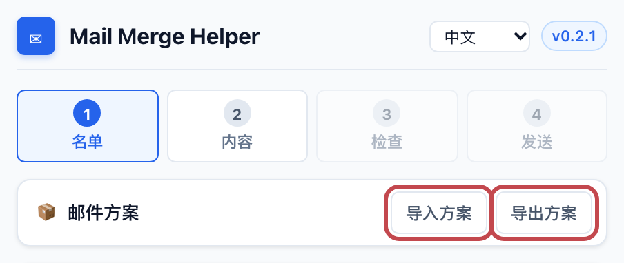

- **导入方案**（或把 `.json` 文件拖到上传区）：填好所有字段并载入名单。检查邮件内容后继续即可。
- **导出方案**：把当前设置保存为 `mail-merge-plan-YYYY-MM-DD.json`。文件里包含收件人名单，请妥善保管。
- 方案文件不会保存自动发送设置，导入后自动发送一律是关闭的。

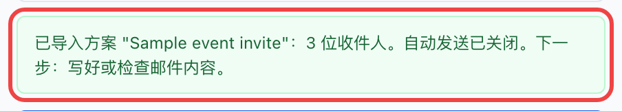

方案文件可以手写或修改。`csv` 和 `body` 可以写成一整段文字，也可以写成按行排列的数组：

```json
{
  "type": "mail-merge-plan",
  "version": 1,
  "name": "Sample event invite",
  "csv": ["FirstName,Email", "Ada,ada@example.com"],
  "subject": "You're invited, {{FirstName}}!",
  "body": ["Hi {{FirstName}},", "", "Hope to see you there!"],
  "settings": { "composeMode": "outlook", "batchDelay": 2000, "batchSize": 50 }
}
```

`composeMode` 可以是 `outlook` 或 `gmail`；`batchDelay` 可以是 `500`、`1000` 或 `2000`（毫秒）；`batchSize` 是 1–500。完整示例见 [`examples/sample-plan.json`](examples/sample-plan.json)。

## 自动发送（实验功能）

勾选 **自动发送** 后，扩展在打开每个写信标签页后还会自动点 **发送**，然后尝试关闭这个标签页。按钮文字会变成 **发送测试给我**、**发送第 1 批** 等，提醒你邮件会直接发出去。

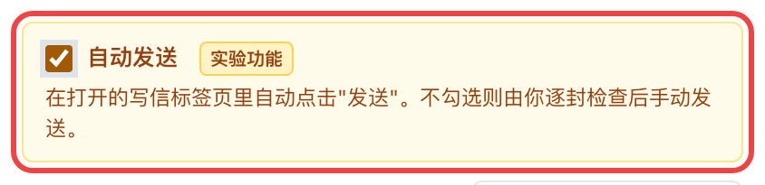

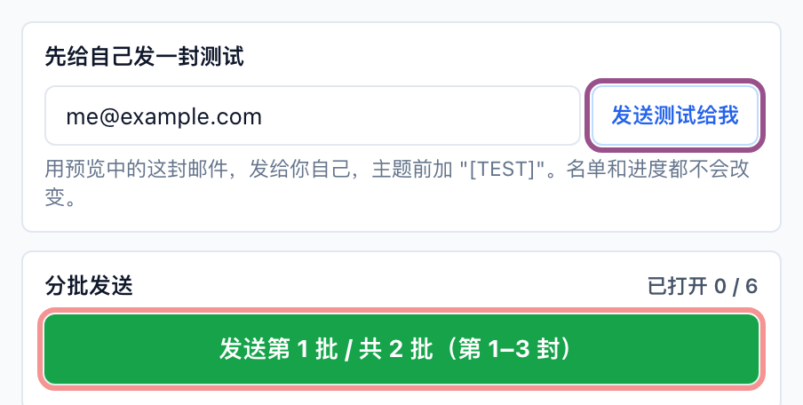

使用前请注意：

- **打开自动发送后，先给自己发一封测试**，确认收到了，并且写信标签页没有停在草稿状态。
- 它只会操作由扩展打开的写信标签页，而且只点对应那封草稿的发送按钮。
- 只认识写着 "Send" 或"发送"的按钮。如果你的 Outlook 或 Gmail 是其他语言，15 秒后会放弃，草稿留给你手动发送。
- Outlook 模式下不能和抄送/密送同时使用（带抄送的草稿走 `mailto:`）。请改用 Gmail 模式，或关掉自动发送。
- 扩展更新后，要在 `chrome://extensions` 里刷新一下，新版本才会生效。

## 界面语言

弹窗右上角的菜单可以切换 **English**、**中文** 和 **Español**。第一次打开时会跟随浏览器的语言，之后会记住你的选择。

## 大批量发送建议

- **每批 40–50 封左右**（默认 50），批次之间隔几分钟。短时间内发出大量邮件，可能会被邮箱服务限流或标记。
- **每次都先给自己发测试**，用自动发送之前尤其要测。
- **打开速度选 `2 秒（稳妥 / 大批量）`**，让浏览器和 Outlook 来得及处理。
- **只载入邮件需要的列**，Excel 选列时其他列默认不载入。
- **看一眼收件人检查**：昵称、私人邮箱、重复的邮箱、缺失的名字，都能在发出去之前发现。

## Excel 和 CSV 格式

名单需要一行表头、至少一行数据和一列邮箱（列名可以是 `Email`、`E-mail`、`Mail`、`邮箱`、`Correo`、`To`，或包含 "email" 的列名）。任何表头都可以当变量用：

```csv
FirstName,LastName,Email,Course,CcEmail
Ada,Lovelace,ada.lovelace@example.com,ISOM 210,ta@example.com
Grace,Hopper,grace.hopper@example.com,ISOM 340,ta@example.com
```

```text
Subject:  Reminder for {{Course}}
Body:     Hi {{FirstName}},

          This is a quick reminder about {{Course}}.
CC:       {{CcEmail}}
```

- **Excel：** 可以直接读取 `.xlsx`，第一行非空的行作为表头。单元格使用 Excel 保存时的值（公式不会重新计算；日期会显示为 Excel 的日期数字，邮件里要用日期的话请把那一列设成文本）。不支持旧版 `.xls`，请另存为 `.xlsx` 或 CSV UTF-8。
- **CSV：** 内容里有逗号或换行时，要用英文双引号括起来。从 Excel 另存时请选 **CSV UTF-8**，中文和其他语言的名字才不会乱码。
- 变量名区分大小写，必须和表头完全一致，包括空格：表头是 `First Name`，变量就是 `{{First Name}}`。
- 可能为空的字段可以在 `|` 后面加默认值：`{{First Name|同学}}`。

## 常见问题

| 问题 | 解决办法 |
|---|---|
| 提示"不支持旧版 .xls 文件" | 在 Excel 里 **文件 → 另存为**，选 `.xlsx` 或 **CSV UTF-8**。 |
| 提示"无法读取这个 Excel 文件" | 用 Excel 打开后重新另存为 `.xlsx`。有密码保护的文件无法读取。 |
| 提示"CSV 需要一行表头和至少一行数据" | 确认第一行是表头，每位收件人单独一行。 |
| 第一步的 **下一步** 是灰色的 | 先载入收件人名单。如果 Excel 选列面板还开着，点 **使用这些列**。 |
| 模板下方提示"名单里没有 {{...}}" | 变量名和表头没有完全一致（拼写、大小写、空格）。用它建议的列名，或输入 `{{` 从列表里选。 |
| 邮件开头变成 "Hi ," 少了名字 | 给变量加默认值：`{{First Name|同学}}`。 |
| 预览里某个名字不对 | 在收件人检查里直接改，或者改好原文件后重新载入。 |
| Outlook 打开了，但收件人或主题是空的 | 先在同一个浏览器里登录 Outlook Web，再重新打开草稿。 |
| 自动发送没有点发送 | 在 `chrome://extensions` 刷新扩展，检查发送按钮的语言，并参考 [自动发送](#自动发送实验功能)。 |
| 按钮显示"所有批次都已打开"，但我需要重发 | 点 **重置进度**，或在 **更多选项** 里打开指定范围。 |
| 想全部重来 | 点 **清除数据**，会清除保存的名单、模板和进度。 |

## 帮助和反馈

遇到问题、有疑问或建议，请到 [GitHub Issues](https://github.com/dimitriparadise/outlook-gmail-mail-merge-chrome--edge-browser-extension/issues) 提问或反馈。弹窗里也有入口：每条错误提示下面，以及弹窗最底部。

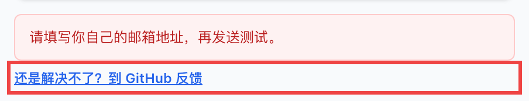

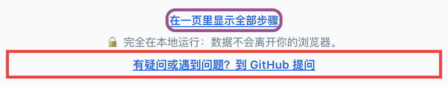

反馈问题时，请写上扩展版本（语言菜单旁边的版本号）、浏览器、用的是 Outlook 还是 Gmail，以及看到的提示原文。**请不要贴真实的收件人名单或学生信息**，用虚构的名字和 `example.com` 邮箱代替。

## 隐私和权限

Mail Merge Draft Helper 没有服务器，不会把你的数据发到任何地方。Excel 和 CSV 文件都在弹窗里读取。载入的名单、模板、生成的草稿和进度保存在浏览器的扩展存储里，这样关掉弹窗再打开也不会丢。点 **清除数据** 可以清除。导出的方案文件只会保存在浏览器的下载位置。

需要的权限：

- `storage`：在本地保存弹窗状态。
- Gmail 和 Outlook 的网站权限：让可选的自动发送脚本找到扩展打开的写信窗口。

扩展不会读取你的邮箱内容，也不使用 Gmail API 或 Microsoft Graph。完整隐私政策见 [store-assets/privacy-policy.md](store-assets/privacy-policy.md)。

## 当前限制

- 不支持附件（草稿是通过写信链接打开的）。
- 正文只支持纯文本，没有富文本格式。
- 正文太长时，可能超出写信链接能携带的长度。
- 自动发送是实验功能，依赖 Outlook / Gmail 页面的结构。

## 开发

1. 克隆这个仓库。
2. 用 **Load unpacked** 直接加载仓库文件夹本身（见 [安装](#安装)）。
3. 修改代码后，在扩展卡片上点刷新。

```bash
node --test
```

```bash
./scripts/build_release.sh
```

- `popup.html` / `popup.js` / `popup.css`：弹窗。`xlsx.js` 负责读取 Excel；`content.js` 是自动发送脚本。
- `i18n.js` 存放弹窗里所有的中英西三语文字。新增文字时三种语言都要加；有测试会检查三种语言的键和 `{占位符}` 是否一致。
- `build_release.sh` 会把扩展文件复制到 `dist/mail-merge-draft-helper/`，并按 `manifest.json` 里的版本号生成 `dist/mail-merge-draft-helper-<版本号>.zip`。

上架 Chrome 应用商店的资料（商店描述、截图、审核说明、检查清单）在 [`store-assets/`](store-assets/) 里。官方文档：

- [Publish in the Chrome Web Store](https://developer.chrome.com/docs/webstore/publish)
- [Chrome Web Store Developer Program Policies](https://developer.chrome.com/docs/webstore/program-policies)
- [Privacy disclosure requirements](https://developer.chrome.com/docs/webstore/program-policies/user-data-faq)
